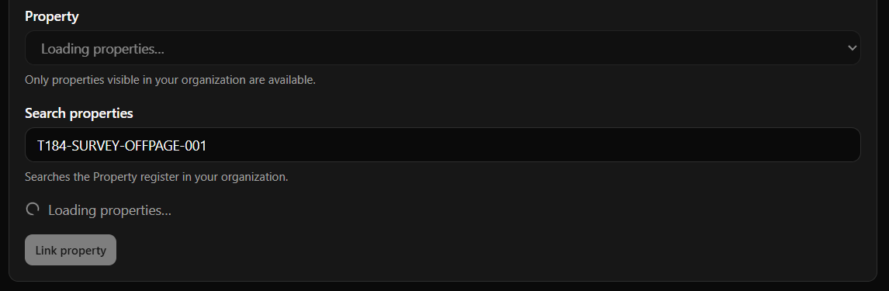
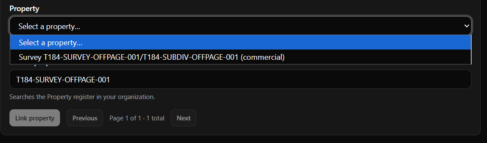
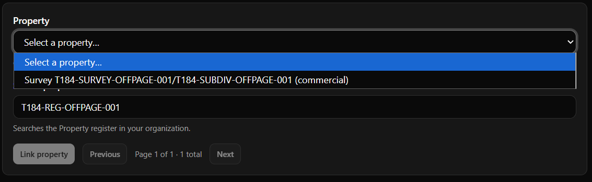
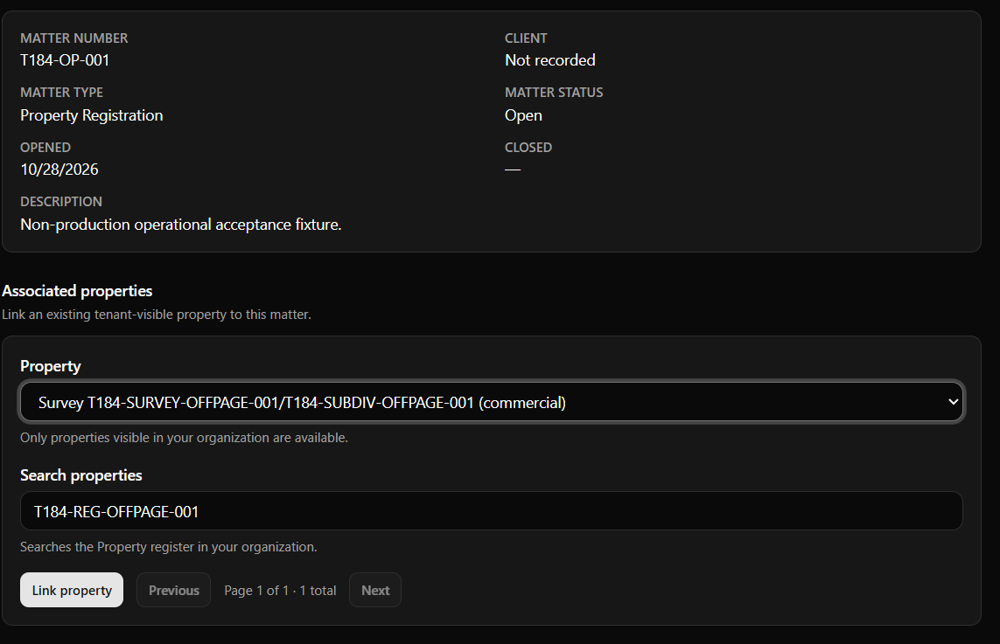

# T184 AC-10 Final Two-Gap Native Windows Electron Verification

**Task:** T184 — Tenant-Scoped Property Search in the Matter Workspace  
**Role:** Windows Electron Operational Acceptance Executor  
**Human operator:** Project Owner  
**Execution date:** 2026-10-29 (Asia/Kolkata)  
**Implementation candidate:** `e41afd2988d1f6e4f46f9e219d56736d6c802a10`  
**Prior operational-evidence commit:** `5b9167aded58417a3232444ba49215819c913747`  
**Scope:** Supplementary operational evidence only; not an Independent QA decision.

This artifact supplements [the human-assisted AC-10 record](AC10_Human_Assisted_Native_Windows_Electron_Operational_Verification.md). It addresses only that record's two explicitly unverified native observations: the visible Property-search loading state and a deliberately delayed stale-response race.

## Determination

**Operational AC-10 PASS — Pending Independent QA.**

The Project Owner directly observed both required behaviors in the packaged native Windows Electron window, with direct screenshots. The controlled interceptor was loopback-only, test-only, and removed after the run. No application source, migration, production system, or production data was changed.

## Candidate and isolated environment

| Item | Recorded value |
|---|---|
| Protected baseline | `d25f3f2d49120cae6af57800383a49a1a0b619da` |
| Implementation candidate | `3780f05b3d39498d0ea4428ba7a3c4d90e974504` |
| Starting operational-evidence head | `5b9167aded58417a3232444ba49215819c913747` |
| Checkout | Isolated `D:\\Code\\Legal_DMS_T184_operational` worktree at the starting evidence head |
| Native app | Packaged `Legal Document & Matter Management System.exe`; Electron 43.3.0; `file:` renderer |
| Backend / data | Disposable PostgreSQL 16 container `legal-dms-t184-operator`, loopback-only database port `55484`; 27 Apex Properties and `T184-OP-001` preserved before and after the run |
| Test operator | Controlled non-production Apex Legal Chambers Advocate account with verified `properties:read` and `matters:write`; credentials and tokens omitted |

## Controlled delay harness

### Request mechanism inspected

The packaged renderer's `listProperties()` adapter sends a real `GET /api/v1/properties?page=<n>&page_size=<n>&search=<value>` request. `MatterDetailPage` keys its async resource by page and normalized search; its cleanup cancels the previous effect, preventing a settled superseded request from writing state.

### Interception configuration

An in-memory Node HTTP reverse proxy was bound only to `127.0.0.1:8001`; the unchanged FastAPI backend was temporarily bound to `127.0.0.1:8002`. The packaged application therefore retained its normal endpoint and all authentication, Authorization headers, tenant context, backend route handling, and response bytes passed through unchanged.

The proxy armed exactly one request only when all of the following matched:

- method `GET`;
- path `/api/v1/properties`;
- exact `search` query value; and
- an explicit one-time local control action.

For a matching request, the proxy forwarded the request immediately, waited for the genuine upstream response, and held its unmodified status, headers, and bytes in memory. There was no fixed timer: **the exact delay was manual-gated from the `held` trace event until an explicit `release` control action**, so release was safe, reproducible, and tied to the operator checkpoint. A `cancel` control action was also available but was not needed. No request body, bearer token, or response content was recorded in the trace; trace fields were only event, test label, search identifier, response status, and hold identifier.

### Cleanup

The proxy was closed after all held responses were released (`pending=0`). The backend was restored to `127.0.0.1:8001`; no listener remained on `8002`; backend health returned HTTP 200. Fixture verification after cleanup remained 27 Properties and Matter `T184-OP-001`.

## Test A — visible loading indicator

| Step | Observation |
|---|---|
| Armed request | `arm-1`, exact search `T184-SURVEY-OFFPAGE-001`, label `loading-indicator` |
| Delayed response | The upstream response was fully received and held as `hold-2`; it was not delivered until manual release after the operator screenshot. |
| Native observation | The operator observed `Loading properties…` in the packaged native Electron window. |
| Release / outcome | `hold-2` was explicitly released. The genuine target result returned with `Page 1 of 1 · 1 total`. |

**Loading indicator: PASS.**

## Test B — deliberately delayed older response

The two distinguishable searches were:

- older, delayed: `T184-SURVEY-OFFPAGE-001`;
- newer, un-delayed: `T184-REG-OFFPAGE-001`.

| Order | Observation |
|---|---|
| 1 | Proxy armed `arm-3` for only the older survey query. |
| 2 | Operator issued the older survey query. The genuine upstream response was held as `hold-4` (the trace confirmed this before the next operator checkpoint). |
| 3 | While `hold-4` remained pending, the operator issued the newer registration query. It completed and rendered the registration query/result with `Page 1 of 1 · 1 total`. |
| 4 | The operator captured the newer rendered state before older-response release. |
| 5 | The executor explicitly released `hold-4`; the proxy confirmed `pending=0`. |
| 6 | The operator confirmed and captured that the UI still showed `T184-REG-OFFPAGE-001`, its newer result, selected Property, and `Page 1 of 1 · 1 total`; the older survey result did not overwrite it. |

The proxy's `held`/`release` trace identifiers establish the delayed response ordering, while the direct native screenshots establish the newer state before and after release. This is a delayed-response race, not a rapid-typing substitute.

**Stale-response protection: PASS.**

## Handoff

Commit this supplementary evidence to PR #403 and request a fresh Independent QA re-review of the resulting exact head. The operational executor does not approve or merge the PR, make an Independent QA decision, perform governance closeout, or authorize T185.
