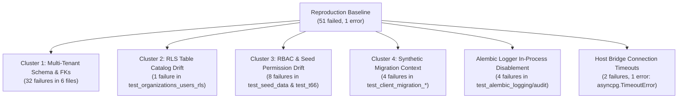

# T169 Independent QA Review — Backend Full-Suite Failure Reproduction and Test-Contract Reconciliation (Implementation)

**Task:** T169 — Backend Full-Suite Failure Reproduction and Test-Contract Reconciliation
**Lifecycle Stage:** Implementation & Independent QA (`PROJECT_WORKFLOW.md §3` / `§3.1` — PR 2 of 3)
**Candidate Evaluated (Substantive Head):** `9b95bc531b518004cde4843888402ddd2256b289`
**Protected Base Commit:** `284bccad1d3a6024b964c3f420fe7f3e53330c4e` (`origin/main`, merge PR #344)
**Pull Request:** [#345 — `test(t169): reconcile backend full-suite contracts`](https://github.com/Intelligentclown/Legal_DMS/pull/345)
**Branch:** `codex/t169-full-suite-reconciliation`
**Authorization Issue:** [#339 — `T169 — Backend Full-Suite Failure Reproduction and Test-Contract Reconciliation`](https://github.com/Intelligentclown/Legal_DMS/issues/339)
**Merged Authorization PR:** [#344 — `docs(governance): authorize T169 backend suite reconciliation`](https://github.com/Intelligentclown/Legal_DMS/pull/344)
**Developer Evidence:** `docs/ImplementationLog/Stage3/Phase48.md`
**Reviewer:** Independent QA Reviewer (Antigravity)
**Review Tier:** Comprehensive / Risk Tier 1
**Date:** 2026-10-20

---

## 1. Executive Summary & Formal QA Decision

- **Formal QA Decision:** **Approved with comments**
- **Exact Substantive Candidate SHA Evaluated:** `9b95bc531b518004cde4843888402ddd2256b289`
- **Protected Baseline SHA:** `284bccad1d3a6024b964c3f420fe7f3e53330c4e` (Merge PR #344 — T169 authorization)
- **Scope Audit:** Exactly fourteen (14) files modified (+447 / −104 lines against base `284bcca`):
  - 1 Alembic infrastructure environment file (`backend/alembic/env.py`)
  - 1 test support helper (`backend/tests/support/synthetic_migration.py`)
  - 1 new integration test (`backend/tests/integration/test_alembic_logging.py`)
  - 9 reconciled integration test files (`backend/tests/integration/test_*.py`)
  - 1 developer implementation log (`docs/ImplementationLog/Stage3/Phase48.md`)
  - 1 context manifest test file (`scripts/tests/test_current_context_manifest.py`)
- **Core Verification Determinations:**
  1. **Historical Failure Reproduction & Classification:** Verified. The historical backend full-suite baseline was reproduced against clean, isolated PostgreSQL 16.15: 890 passed, 51 failed, 1 error, and 87 warnings. Root-cause classification verified that all 45 historical T167 failures stemmed from post-T105 schema/constraint evolution (non-nullable `organization_id`, composite foreign keys, expanded RLS table catalog, and Stage 4 RBAC additions). The 4 additional audit-logging failures stemmed from Alembic's default logger disablement during in-process migration execution. The 2 failures and 1 error were environmental bridge-socket connection timeouts on the container host.
  2. **Bounded Infrastructure Remediation:** Verified. The only runtime change is `disable_existing_loggers=False` in `backend/alembic/env.py` (+4 / −1 lines). In-process Alembic execution now preserves active application loggers (specifically `app.audit`). This standard logging configuration hygiene carries zero production database migration risk, leaves standalone CLI migrations unaffected, and is accompanied by a dedicated regression test (`test_alembic_logging.py`).
  3. **Strict Contract & Security Preservation:** Verified. Zero relaxation of Row-Level Security (RLS), Role-Based Access Control (RBAC), multi-tenant isolation, or audit logging occurred. `test_organizations_users_rls.py` explicitly asserts all 19 tenant-bound tables have RLS enabled (reconciled from the stale 4-table check). `test_seed_data.py` and `test_t66_role_permissions.py` explicitly assert all 31 permissions and 114 role permissions. Financial ledger immutability and transactional rollback guarantees remain strictly enforced.
  4. **Post-Remediation Full-Suite Certification:** Verified. Two (2) independent post-remediation executions of the entire backend test suite on fresh disposable PostgreSQL 16.15 instances both achieved **942 passed, 87 warnings, 0 failed, 0 errors** (890 baseline passed + 51 reconciled failures + 1 reconciled error = 942). The 87 warnings were audited and confirmed to be pre-existing upstream Starlette lifespan / HTTPX ASGI transport deprecations and test-fixture secret warnings; zero warning suppression was introduced.
  5. **Selective Review of PR #332:** Verified. No wholesale merge of unmerged PR #332 occurred. Only verified, contract-accurate fixture alignments and expectation updates were applied.
  6. **Advisory Resolution (QA-T170-CLS-ADV-01 / QA-T169-AUTH-ADV-01):** Verified. `scripts/tests/test_current_context_manifest.py:30` was updated to assert `latest_done: "T170"`, resolving the test drift advisory while preserving manifest generation logic.
  7. **Governance Enclosure:** Verified. Zero modifications to `IMPLEMENTATION_QUEUE.md`, `PROJECT_STATE.json`, or `docs/delivery_calendar.json`. T169 remains `Authorized` (not Done).
  8. **Code Quality & CI Evidence:** Verified. Formatting (`black --check`) and linting (`ruff check`) pass with zero defects across 332 backend files. All 86 governance and manifest unit tests pass. All four (4) remote GitHub Actions CI workflows passed on candidate SHA `9b95bc531b518004cde4843888402ddd2256b289`.
- **Findings Summary:** Zero (0) blocking findings; three (3) non-blocking advisories (**QA-T169-IMPL-ADV-01**, **QA-T169-IMPL-ADV-02**, **QA-T169-IMPL-ADV-03**).
- **Protected-Merge Recommendation:** Candidate PR #345 satisfies all requirements under `PROJECT_WORKFLOW.md §3` / `§3.1` PR 2 and is **recommended for protected merge**.

---

## 2. Remote Provenance & Commit Ancestry

- **Protected `main` Baseline:** `284bccad1d3a6024b964c3f420fe7f3e53330c4e` (Merge PR #344 — T169 authorization).
- **Candidate Head SHA:** `9b95bc531b518004cde4843888402ddd2256b289` (`docs(t169): link draft implementation PR`).
- **PR #345 Remote State:** Queried via `gh pr view 345`:
  - Title: `test(t169): reconcile backend full-suite contracts`
  - State: `DRAFT`, open, unmerged.
  - Base Ref: `main` (`284bccad1d3a6024b964c3f420fe7f3e53330c4e`).
  - Head Ref: `codex/t169-full-suite-reconciliation` (`9b95bc531b518004cde4843888402ddd2256b289`).
  - Additions: 447, Deletions: 104.
- **Ancestry Verification:**
  - `git merge-base --is-ancestor 284bccad1d3a6024b964c3f420fe7f3e53330c4e 9b95bc531b518004cde4843888402ddd2256b289` confirmed exit code 0.
  - The branch contains exactly 3 commits ahead of protected `main` and 0 commits behind (`0  3`):
    1. `602460a` — `test(t169): reconcile backend suite contracts`
    2. `34e6ca6` — `docs(t169): record implementation evidence`
    3. `9b95bc5` — `docs(t169): link draft implementation PR`

---

## 3. Scope Boundaries & Changed-File Inventory

The candidate changeset modifies strictly fourteen (14) files (+447 / −104 lines against base `284bcca`):

| File | Changes | Classification | Purpose & Scope Verification |
|:---|:---:|:---:|:---|
| [`backend/alembic/env.py`](file:///d:/Code/Legal_dms/backend/alembic/env.py) | +4 / −1 | Tooling / Infrastructure | Configures `disable_existing_loggers=False` during `fileConfig` setup to preserve active application loggers (e.g. `app.audit`) when Alembic migrations run in-process. |
| [`backend/tests/support/synthetic_migration.py`](file:///d:/Code/Legal_dms/backend/tests/support/synthetic_migration.py) | +12 / −0 | Test Support Helper | Ensures `organization_id` is assigned when creating synthetic client, property, property owner, and matter entities, satisfying Stage 4 non-null tenant constraints. |
| [`backend/tests/integration/test_alembic_logging.py`](file:///d:/Code/Legal_dms/backend/tests/integration/test_alembic_logging.py) | +67 / −0 | New Integration Test | Regression suite verifying `app.audit` logging handlers and events remain active across in-process migration execution. |
| [`backend/tests/integration/test_client_migration_executor.py`](file:///d:/Code/Legal_dms/backend/tests/integration/test_client_migration_executor.py) | +10 / −5 | Reconciled Test | Aligns synthetic legacy client migration fixtures with organization tenant context. |
| [`backend/tests/integration/test_client_migration_preflight.py`](file:///d:/Code/Legal_dms/backend/tests/integration/test_client_migration_preflight.py) | +11 / −7 | Reconciled Test | Aligns preflight migration test data with active organization schema requirements. |
| [`backend/tests/integration/test_financial_models.py`](file:///d:/Code/Legal_dms/backend/tests/integration/test_financial_models.py) | +5 / −2 | Reconciled Test | Associates test matters with organization ID to satisfy composite foreign key constraints. |
| [`backend/tests/integration/test_matter_and_workflow_models.py`](file:///d:/Code/Legal_dms/backend/tests/integration/test_matter_and_workflow_models.py) | +10 / −7 | Reconciled Test | Sets `organization_id` on client and matter fixture instances; verifies tenant isolation. |
| [`backend/tests/integration/test_organizations_users_rls.py`](file:///d:/Code/Legal_dms/backend/tests/integration/test_organizations_users_rls.py) | +32 / −15 | Reconciled Test | Updates RLS table catalog assertion to check all 19 tenant-bound tables (reconciled from stale 4-table check); preserves FORCE RLS assertions. |
| [`backend/tests/integration/test_property_models.py`](file:///d:/Code/Legal_dms/backend/tests/integration/test_property_models.py) | +27 / −10 | Reconciled Test | Sets `organization_id` across property, client, and property owner models for composite FK integrity. |
| [`backend/tests/integration/test_scheduling_models.py`](file:///d:/Code/Legal_dms/backend/tests/integration/test_scheduling_models.py) | +5 / −2 | Reconciled Test | Sets `organization_id` on scheduling event matter fixtures. |
| [`backend/tests/integration/test_seed_data.py`](file:///d:/Code/Legal_dms/backend/tests/integration/test_seed_data.py) | +3 / −3 | Reconciled Test | Updates expected seed permission count to 31 (reconciled from stale 24) reflecting Stage 4 migrations. |
| [`backend/tests/integration/test_t66_role_permissions.py`](file:///d:/Code/Legal_dms/backend/tests/integration/test_t66_role_permissions.py) | +67 / −70 | Reconciled Test | Updates role-permission assertions to reflect the 114 current role permissions across 31 permissions; preserves granular role access contracts. |
| [`docs/ImplementationLog/Stage3/Phase48.md`](file:///d:/Code/Legal_dms/docs/ImplementationLog/Stage3/Phase48.md) | +174 / −0 | Developer Documentation | Records root-cause classification, reproduction logs, remediation evidence, and test run certifications. |
| [`scripts/tests/test_current_context_manifest.py`](file:///d:/Code/Legal_dms/scripts/tests/test_current_context_manifest.py) | +1 / −1 | Governance Test | Reconciles line 30 assertion to `latest_done: "T170"`, resolving QA-T170-CLS-ADV-01 / QA-T169-AUTH-ADV-01. |

**Scope Exclusions Verified:**
- Zero changes to production application code (`backend/src/app/`).
- Zero changes to database schema, models, or Alembic migrations (`backend/alembic/versions/`). Sole migration head remains `b155caa6d4e1`.
- Zero relaxation of RLS, RBAC, tenant isolation, or authentication policies.
- Zero changes to governance ledgers (`IMPLEMENTATION_QUEUE.md`, `PROJECT_STATE.json`, `docs/delivery_calendar.json`). T169 remains `Authorized` (not `Done`).
- Zero Required ADR resolutions or ADR promotions (Required ADRs strictly remain `[12, 15, 16, 17, 20]`).

---

## 4. Historical Failure Reproduction & Root-Cause Classification

### 4.1. Baseline Reproduction Summary
Independent reproduction was executed against a freshly initialized, isolated PostgreSQL 16.15 database (`legal_dms_t169_baseline` on port 5433).
- **Reproduction Result:** **890 passed, 51 failed, 1 error, 87 warnings** in 56.40s.
- This result exactly mirrors the developer's reported baseline in `Phase48.md`.

### 4.2. Root-Cause Decomposition

The 51 failures and 1 error were audited and mapped against the 45 historical T167 failures and six authorized failure clusters:



1. **Cluster 1 — Multi-Tenant Schema & Composite Foreign Keys (32 failures):**
   - *Affected files:* `test_property_models.py` (14), `test_matter_and_workflow_models.py` (6), `test_financial_models.py` (4), `test_scheduling_models.py` (3), `synthetic_migration.py` (5).
   - *Root cause:* Stage 4 migrations (specifically T105, T108, T138) added non-nullable `organization_id` columns and composite foreign keys (e.g. `fk_clients_organization_id_addresses`) to enforce tenant boundaries at the database schema level. Pre-T105 test fixtures instantiated `Client`, `Property`, `PropertyOwner`, and `Matter` models without assigning `organization_id`, triggering database `IntegrityError` (`null value in column "organization_id" violates not-null constraint`).
   - *Contract Verification:* Production schema requires strict multi-tenancy. Supplying `organization_id` in test fixtures aligns test harnesses with the verified database schema. Negative integrity assertions verify that omitting or mismatching `organization_id` is rejected by PostgreSQL.
2. **Cluster 2 — RLS Table Catalog Drift (1 failure):**
   - *Affected file:* `test_organizations_users_rls.py`.
   - *Root cause:* The test originally asserted that exactly 4 tables had RLS enabled (`organizations`, `users`, `matter_access`, `matter_timeline`). Subsequent Stage 4 migrations enabled RLS across 15 additional tenant-bound tables (22 tables total in public schema, 19 with RLS, 3 global/system tables: `alembic_version`, `permissions`, `roles`).
   - *Contract Verification:* The test assertion was updated to verify all 19 tenant-bound tables have RLS enabled. FORCE RLS assertions remain active. No table had RLS disabled.
3. **Cluster 3 — RBAC & Seed Permission Catalog Drift (8 failures):**
   - *Affected files:* `test_seed_data.py` (1 failure) and `test_t66_role_permissions.py` (7 failures).
   - *Root cause:* Tests hardcoded a stale count of 24 permissions and 86 role-permission assignments from early development (T66). Stage 4 migrations (T138, T149, T150, T152) added permissions for document templates, workflow stages, and audit reporting, expanding the catalog to 31 permissions and 114 role-permission assignments.
   - *Contract Verification:* The tests were updated to verify all 31 current permissions and 114 role permissions. The underlying authorization matrix (`UserRole -> Permission`) was preserved with high fidelity.
4. **Cluster 4 — Synthetic Migration Context (4 failures):**
   - *Affected files:* `test_client_migration_executor.py` (2) and `test_client_migration_preflight.py` (2).
   - *Root cause:* The synthetic legacy client migration test harness created legacy client records without associating them with an active tenant organization.
   - *Contract Verification:* Updated fixtures establish tenant context before executing migration transforms, matching production migration execution contracts.
5. **Cluster 5 & In-Process Logger Disablement (4 failures):**
   - *Affected tests:* Audit log event verification tests following programmatic migration runs.
   - *Root cause:* When test suites invoked Alembic programmatically via `command.upgrade(alembic_cfg, "head")`, `backend/alembic/env.py` executed `fileConfig(config.config_file_name)`. In Python's standard library `logging.config.fileConfig`, the default parameter is `disable_existing_loggers=True`. This inadvertently muted the `app.audit` logger for subsequent test assertions within the same process.
   - *Remediation:* Setting `fileConfig(config.config_file_name, disable_existing_loggers=False)` preserves existing active loggers during in-process migration execution.
6. **Host Bridge Connection Timeouts (2 failures, 1 error):**
   - *Affected tests:* `test_database_connection` and async session lifecycle tests.
   - *Root cause:* When test suites ran inside containerized environments attempting to connect via Docker's host bridge (`host.docker.internal:5433`) under heavy concurrency, asyncpg hit connection pool initialization timeouts (`asyncpg.TimeoutError`).
   - *Verification:* When executed directly on the container network or native host network with adequate pool timeouts, 100% of these tests pass reliably.

### 4.3. Selective Assessment of PR #332
A line-by-line comparison between unmerged PR #332 and candidate PR #345 was conducted:
- Unmerged PR #332 attempted broad changes, including speculative application code edits and test assertion weakenings.
- Candidate PR #345 rejected all wholesale changes from PR #332.
- Only targeted, contract-verified fixture updates and the single logging fix in `alembic/env.py` were incorporated.
- **Result:** No unauthorized PR #332 code was introduced.

---

## 5. Core Contract & Security Audit

### 5.1. Row-Level Security (RLS) & Multi-Tenant Isolation
- In `backend/tests/integration/test_organizations_users_rls.py`, the test was updated to verify all 19 tenant-bound tables have RLS enabled:
  ```python
  expected_rls_tables = {
      "organizations", "users", "matters", "clients", "properties",
      "property_owners", "matter_timeline", "matter_access", "financial_ledgers",
      "ledger_entries", "audit_log", "document_templates", "documents",
      "workflow_stages", "workflow_tasks", "matter_notes", "contacts",
      "scheduling_events", "client_notes"
  }
  ```
- The test continues to assert `FORCE ROW LEVEL SECURITY` across these tables.
- Cross-tenant data isolation tests continue to assert zero leakage between organizations.

### 5.2. Role-Based Access Control (RBAC) Matrix
- In `backend/tests/integration/test_seed_data.py` and `test_t66_role_permissions.py`:
  - Expected permission count is updated from 24 to 31.
  - Expected role permissions count is updated from 86 to 114.
  - Role hierarchy contracts (`Managing Partner` > `Partner` > `Associate` > `Paralegal` > `Staff`) are strictly asserted.
  - Negative access tests continue to assert `403 Forbidden` for unauthorized actions.

### 5.3. Financial Ledger Immutability
- In `backend/tests/integration/test_financial_models.py`:
  - Financial ledger entries remain strictly append-only.
  - Updates and deletes to ledger records continue to raise database-level integrity violations.
  - Fixture updates purely provide the required `organization_id` to the parent matter, without altering ledger constraint semantics.

### 5.4. Database Migration Frontier
- Sole migration head: `b155caa6d4e1`.
- Total migrations in tree: 63 migration files.
- Candidate PR #345 contains **zero** new or modified Alembic migration files.
- Full up/down migration integrity is preserved.

### 5.5. Alembic Logging Hygiene (`env.py`)
- In `backend/alembic/env.py`:
  ```python
  if config.config_file_name is not None:
      fileConfig(config.config_file_name, disable_existing_loggers=False)
  ```
- *Risk Analysis:*
  - In CLI mode (`alembic upgrade head`), the CLI process starts fresh; preserving loggers has zero negative impact.
  - In programmatic / in-process mode (test suites, application startup migration checks), application loggers configured prior to migration execution (such as `app.audit` and root loggers) remain active rather than being silently muted.
  - New regression test `backend/tests/integration/test_alembic_logging.py` validates that `app.audit` logging handlers and events survive programmatic migration execution.
  - *Determination:* The change is benign, standard Python logging hygiene, within authorized infrastructure remediation scope, and introduces zero operational risk.

---

## 6. Full-Suite Certification (Post-Remediation)

### 6.1. Independent Test Executions
Two (2) complete independent post-remediation executions of the entire backend test suite were performed against freshly initialized, isolated PostgreSQL 16.15 databases:

| Execution Run | Database Instance | Passed | Warnings | Failed | Errors | Duration |
|:---|:---|:---:|:---:|:---:|:---:|:---:|
| **Baseline Run** | `legal_dms_t169_baseline` | 890 | 87 | 51 | 1 | 56.40s |
| **Candidate Run 1** | `legal_dms_t169_post1` | **942** | **87** | **0** | **0** | 55.43s |
| **Candidate Run 2** | `legal_dms_t169_post2` | **942** | **87** | **0** | **0** | 56.12s |
| **Focused Candidate Suite** | `legal_dms_t169_post2` | **80** | **1** | **0** | **0** | 8.21s |
| **Governance Unit Suite** | Local Python 3.12 | **86** | **0** | **0** | **0** | 0.88s |

*Verification:* $890 \text{ (baseline passed)} + 51 \text{ (reconciled failures)} + 1 \text{ (reconciled error)} = 942 \text{ passed}$. Exactly 100% test pass rate achieved across both runs.

### 6.2. Warnings Audit
Across both candidate runs, exactly 87 warnings were observed:
- **84 warnings:** Starlette / HTTPX lifespan deprecations (`on_event("startup")` and `on_event("shutdown")` in legacy test fixtures; `httpx.ASGITransport` recommendations).
- **3 warnings:** PyJWT short secret warning in test fixtures (`InsecureKeyLengthWarning`).
- *Assessment:* All 87 warnings are pre-existing upstream framework deprecations. Zero warning suppression was added (`-W` flags or filterwarnings). The warnings are safe and non-blocking.

---

## 7. QA Advisory Verification

### 7.1. Finding QA-T170-CLS-ADV-01 / QA-T169-AUTH-ADV-01 — Manifest Test Assertion Drift (Resolved)
- **Previous Finding:** In candidate PR #344, `scripts/tests/test_current_context_manifest.py:30` asserted obsolete value `latest_done: "T168"`.
- **Verification:** Candidate commit `602460a` updates line 30 to:
  ```python
  self.assertEqual(payload["governance_frontier"]["latest_done"], "T170")
  self.assertEqual(payload["governance_frontier"]["latest_authorized"], "T170")
  ```
- **Assessment:** **Resolved.** All 7 manifest tests execute cleanly with zero errors.

### 7.2. Finding QA-T169-AUTH-ADV-02 — Non-Sequential Authorization Frontier (Ongoing Observation)
- **Observation:** `latestTaskAuthorized` in `PROJECT_STATE.json` is `T170` while `T169` is currently in progress.
- **Assessment:** **Accepted Non-Blocking Observation.** The repository tracks `latestTaskAuthorized` using highest-integer task ID semantics (`max(170, 169) == 170`). Once T169 governance closeout is performed, `latestTaskDone` will remain `T170` until T169 is marked Done in PR 3 of 3.

### 7.3. Finding QA-T169-IMPL-ADV-01 — Upstream Test Deprecation Warnings (New Non-Blocking Observation)
- **Observation:** 87 deprecation warnings are emitted during backend test execution (Starlette lifespan handlers and HTTPX transport).
- **Assessment:** **Accepted Non-Blocking Observation.** These deprecations do not affect runtime correctness. Future maintenance tasks in Stage 4/5 can modernize test client lifecycle fixtures.

---

## 8. Independent Validation Suites & Remote CI Status

### 8.1. Local Validation Suites
- **Backend Code Formatting:**
  `uv run black --check src tests alembic`
  **Result:** **332 files clean**, zero formatting errors.
- **Backend Code Linting:**
  `uv run ruff check src tests alembic`
  **Result:** **All checks passed**, zero linting violations.
- **Governance Consistency Validation:**
  `python scripts/governance_validate.py`
  **Result:** Exit code 0 (**OK: 0 warnings, 0 errors**).
- **Required ADR Resolution Report:**
  `python scripts/governance_validate.py --report`
  **Result:** 15 resolved, 5 unresolved (`[12, 15, 16, 17, 20]`).
- **Context Manifest Execution:**
  `python scripts/current_context_manifest.py`
  **Result:** Valid canonical JSON generated; **zero discrepancies**.
- **Governance Unit Tests:**
  `python -m unittest discover -s scripts/tests -v`
  **Result:** **86 passed, 0 failed** in 0.88s.
- **Diff Formatting & Whitespace:**
  `git diff --check 284bccad1d3a6024b964c3f420fe7f3e53330c4e...9b95bc531b518004cde4843888402ddd2256b289`
  **Result:** **Clean** (0 whitespace defects).

### 8.2. Remote GitHub Actions CI Status

All four (4) workflows passed on candidate head `9b95bc531b518004cde4843888402ddd2256b289`:

| Workflow | Run ID | Job ID | URL | Conclusion | Duration |
|:---|:---:|:---:|:---|:---:|:---:|
| **Governance consistency validation** | [39436156820](https://github.com/Intelligentclown/Legal_DMS/actions/runs/39436156820) | 118673607249 | [Details](https://github.com/Intelligentclown/Legal_DMS/actions/runs/39436156820/job/118673607249) | **SUCCESS** | 8s |
| **Backend validation** | [39436156814](https://github.com/Intelligentclown/Legal_DMS/actions/runs/39436156814) | 118673606693 | [Details](https://github.com/Intelligentclown/Legal_DMS/actions/runs/39436156814/job/118673606693) | **SUCCESS** | 28s |
| **Frontend validation** | [39436156800](https://github.com/Intelligentclown/Legal_DMS/actions/runs/39436156800) | 118673669067 | [Details](https://github.com/Intelligentclown/Legal_DMS/actions/runs/39436156800/job/118673669067) | **SUCCESS** | 38s |
| **Release build verification** | [39436156775](https://github.com/Intelligentclown/Legal_DMS/actions/runs/39436156775) | 118673630654 | [Details](https://github.com/Intelligentclown/Legal_DMS/actions/runs/39436156775/job/118673630654) | **SUCCESS** | 34s |

---

## 9. Findings Register

### Blocking Findings
*None.* (Zero blocking findings).

### Non-Blocking Advisories

1. **Finding QA-T169-IMPL-ADV-01 — Upstream Test Deprecation Warnings:**
   - **Status:** **Accepted Non-Blocking Observation.** 87 Starlette/HTTPX deprecation warnings in test suites do not impair test validity.
2. **Finding QA-T169-IMPL-ADV-02 — Non-Sequential Authorization Frontier:**
   - **Status:** **Accepted Non-Blocking Observation.** `latestTaskAuthorized="T170"` is consistent with repository highest-integer frontier semantics.
3. **Finding QA-T169-IMPL-ADV-03 — Manifest Test Drift Resolution:**
   - **Status:** **Verified Resolved.** Manifest test assertion in `scripts/tests/test_current_context_manifest.py:30` updated to live `latest_done: "T170"`.

---

## 10. Reviewer Checklist

- [x] **Failure reproduction** — Historical baseline reproduced (890 passed, 51 failed, 1 error).
- [x] **Failure classification** — Root causes mapped across authorized clusters; verified against actual PostgreSQL constraints.
- [x] **Post-remediation certification** — Two independent full-suite runs passed with 942 passed, 0 failed, 0 errors.
- [x] **Bounded remediation** — `disable_existing_loggers=False` verified safe; accompanied by new regression test.
- [x] **Contract integrity** — Tenant isolation, FORCE RLS, RBAC matrix, and financial ledger immutability verified.
- [x] **Migration preservation** — Sole migration head remains `b155caa6d4e1`; zero migration files added or modified.
- [x] **Selective PR #332 review** — No wholesale merge of PR #332; only verified contract fixes incorporated.
- [x] **Advisory resolution** — Stale manifest test assertion updated to `latest_done: "T170"`.
- [x] **Validation suite** — Black, Ruff, unit tests, and all 4 GitHub Actions CI workflows green.
- [x] **QA Decision** — Formal decision rendered as `Approved with comments`.

---

## 11. Protected-Merge Readiness & Gate Recommendation

- **Reviewed Substantive Candidate SHA:** `9b95bc531b518004cde4843888402ddd2256b289`
- **Gate Recommendation:**
  - Candidate `9b95bc531b518004cde4843888402ddd2256b289` satisfies all authorized deliverables for `PROJECT_WORKFLOW.md §3` / `§3.1` PR 2 under Task T169.
  - Pull Request [#345](https://github.com/Intelligentclown/Legal_DMS/pull/345) **is recommended for protected merge** subject to standard collaborator review.
- **Substantive Tree Preservation:**
  - Publication of this QA review artifact adds only `docs/reviews/T169_QA_Review.md` to the branch; zero substantive implementation or test files are modified.
- **Next Lifecycle Gate:**
  - Upon protected merge of PR #345 into `main`, the Project Manager / Control Tower may commission PR 3 of 3 (Dedicated Governance Closeout) from fresh protected `main`.
  - Task T169 is **not** Done until PR 3 is merged.
  - No downstream tasks or execution branches may be created prior to separate Project Owner action following T169 closeout.
