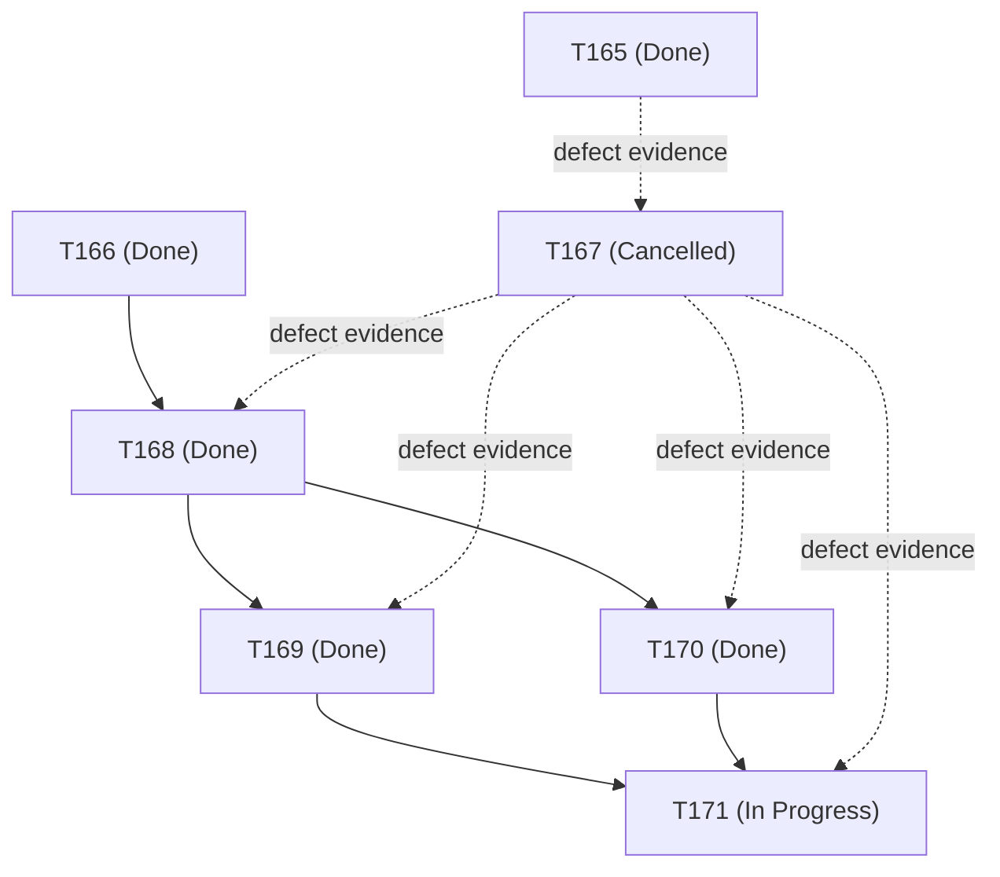

# T171 Independent QA Review — M2 Scope, Dependency and Capacity Baseline Verification (Implementation)

**Task:** T171 — M2 Scope, Dependency and Capacity Baseline Verification
**Lifecycle Stage:** Implementation & Independent QA (`PROJECT_WORKFLOW.md §3` / `§3.1` — PR 2 of 3)
**Candidate Evaluated (Substantive Head):** `3b34c563fb48f03998fe4c73300e10b89f4332d5`
**Protected Base Commit:** `884ba8a5523bc9fff15e3fb8290107c024d28ffa` (`origin/main`, merge PR #348)
**Pull Request:** [#349 — `docs(t171): establish M2 planning baseline`](https://github.com/Intelligentclown/Legal_DMS/pull/349)
**Branch:** `codex/t171-m2-planning-baseline`
**Authorization Issue:** [#347 — `T171 — M2 Scope, Dependency and Capacity Baseline Verification`](https://github.com/Intelligentclown/Legal_DMS/issues/347)
**Merged Authorization PR:** [#348 — `docs(governance): authorize T171 M2 baseline verification`](https://github.com/Intelligentclown/Legal_DMS/pull/348)
**Developer Evidence:** `docs/ImplementationLog/Stage3/Phase49.md`
**Reviewer:** Independent QA Reviewer (Antigravity)
**Review Tier:** Comprehensive / Risk Tier 1
**Date:** 2026-10-20

---

## 1. Executive Summary & Formal QA Decision

- **Formal QA Decision:** **Approved with comments**
- **Exact Substantive Candidate SHA Evaluated:** `3b34c563fb48f03998fe4c73300e10b89f4332d5`
- **Protected Baseline SHA:** `884ba8a5523bc9fff15e3fb8290107c024d28ffa` (Merge PR #348 — T171 authorization)
- **Scope Audit:** Strictly two (2) planning and implementation documentation files modified (+237 / −0 lines against base `884ba8a`):
  1. [`docs/planning/T171_M2_Scope_Dependency_and_Capacity_Baseline.md`](file:///d:/Code/Legal_dms/docs/planning/T171_M2_Scope_Dependency_and_Capacity_Baseline.md) (+117 / −0)
  2. [`docs/ImplementationLog/Stage3/Phase49.md`](file:///d:/Code/Legal_dms/docs/ImplementationLog/Stage3/Phase49.md) (+120 / −0)
- **Core Verification Determinations:**
  1. **Exhaustive Capability Inventory:** Verified. The baseline provides an authoritative inventory of Core V1/M2 capabilities mapped across functional specification Tasks A–O. Each capability is classified with source authority, existing implementation status at cut-off, available test evidence, known gaps / blocking dependencies, remaining verification, and confidence levels.
  2. **Rigorous Operational-Readiness Boundaries:** Verified. The candidate meticulously distinguishes existing codebase/schema artifacts from operational release readiness. It explicitly reaffirms that M1 conditional acceptance was granted solely for operational dogfooding and does not constitute production release approval. It acknowledges that T169's automated 942-pass full-suite certification on isolated PostgreSQL does not substitute for integrated office workflow or native Electron operational acceptance.
  3. **Typed Dependency Verification:** Verified. Dependencies are correctly typed: T169 and T170 are valid `finish_to_start` predecessors; T167 is strictly retained as non-scheduling `defect_evidence`. The candidate affirms that cancelled tasks cannot satisfy scheduling predecessor relationships.
  4. **Transparent Capacity & Scheduling Limits:** Verified. The baseline clearly separates confirmed governance lifecycle facts (independent QA, collaborator reviews, protected merges, closeouts) from unverified resource capacity (individual availability, throughput, work hours). It recognizes that without a complete downstream estimated task network, no project critical path or valid slack can be certified, preserving provisional calendar forecasts (M1: 2026-11-15, M2: 2026-12-31, M3: 2027-02-28).
  5. **Sensitivity Delivery Scenarios:** Verified. Three illustrative delivery scenarios (Optimistic: 36–48 days; Base: 65–85 days; Conservative: 110–150 days) are presented with transparent modeling assumptions, governance overhead accounting, and explicit invalidation triggers. These are strictly documented as sensitivity models rather than calendar forecast adjustments.
  6. **Non-Authorizing Successor Recommendation:** Verified. The recommended next task ("M2 executable task-network and capacity evidence capture") is strictly bounded, planning-only, non-authorizing, and appropriately assigns execution to the Project Manager / Control Tower with Software Architect input.
  7. **Preserved Governance Invariants & Scope Enclosure:** Verified. Zero changes to production application code, tests, database migrations, or schemas (sole head remains `b155caa6d4e1`). Zero changes to governance ledgers (`IMPLEMENTATION_QUEUE.md`, `PROJECT_STATE.json`, `docs/delivery_calendar.json`). T171 strictly remains `Authorized` (not Done). Required ADRs `[12, 15, 16, 17, 20]` strictly remain unresolved.
  8. **Validation & CI Status:** Verified. All local checks pass (governance consistency: 0 errors; delivery calendar: 0 errors/0 alerts; current-context manifest: 0 discrepancies; unit tests: 86 passed). All four (4) remote GitHub Actions workflows passed on candidate head `3b34c563fb48f03998fe4c73300e10b89f4332d5`.
- **Findings Summary:** Zero (0) blocking findings; three (3) non-blocking advisories (**QA-T171-ADV-01**, **QA-T171-ADV-02**, **QA-T171-ADV-03**).
- **Protected-Merge Recommendation:** Candidate PR #349 satisfies all authorized deliverables for `PROJECT_WORKFLOW.md §3` / `§3.1` PR 2 under Task T171 and is **recommended for protected merge**.

---

## 2. Remote Provenance & Commit Ancestry

- **Protected `main` Baseline:** [`884ba8a5523bc9fff15e3fb8290107c024d28ffa`](https://github.com/Intelligentclown/Legal_DMS/commit/884ba8a5523bc9fff15e3fb8290107c024d28ffa) (Protected merge of T171 authorization PR #348).
- **Candidate Head SHA:** `3b34c563fb48f03998fe4c73300e10b89f4332d5`.
- **PR #349 Remote State:** Queried via `gh pr view 349`:
  - Title: `docs(t171): establish M2 planning baseline`
  - State: `OPEN`, unmerged.
  - Base Ref: `main` (`884ba8a5523bc9fff15e3fb8290107c024d28ffa`).
  - Head Ref: `codex/t171-m2-planning-baseline` (`3b34c563fb48f03998fe4c73300e10b89f4332d5`).
  - Commits: Exactly 2 commits ahead of protected `main`, 0 behind:
    1. `a596c47` docs(t171): establish M2 planning baseline
    2. `3b34c56` docs(t171): record planning baseline commit
- **Ancestry Verification:**
  - `git merge-base --is-ancestor 884ba8a5523bc9fff15e3fb8290107c024d28ffa 3b34c563fb48f03998fe4c73300e10b89f4332d5` confirmed exit code 0.
- **Prerequisite Merge Verification:**
  - PR #348 merge commit `884ba8a5523bc9fff15e3fb8290107c024d28ffa`: ordered parents `9e46d3e` (PR #346 closeout merge), `f407bd5` (T171 authorization QA publication head).
  - Confirmed strictly present in protected `main` ancestry.

---

## 3. Scope Boundaries & Changed-File Inventory

The candidate changeset modifies strictly two (2) planning and implementation log files (+237 / −0 lines against base `884ba8a`):

| File | Changes | Classification | Purpose & Scope Verification |
|:---|:---:|:---:|:---|
| [`docs/planning/T171_M2_Scope_Dependency_and_Capacity_Baseline.md`](file:///d:/Code/Legal_dms/docs/planning/T171_M2_Scope_Dependency_and_Capacity_Baseline.md) | +117 / −0 | Planning Artifact | Authoritative baseline covering Core V1 capability inventory, operational-readiness boundaries, typed dependencies, capacity evidence matrix, non-official delivery scenarios, non-authorizing successor recommendation, and reproduction checklist. |
| [`docs/ImplementationLog/Stage3/Phase49.md`](file:///d:/Code/Legal_dms/docs/ImplementationLog/Stage3/Phase49.md) | +120 / −0 | Documentation | Documents execution objective, inspected surfaces, design decisions, verification results, deferred work, and reviewer checklist. |

**Scope Exclusions Verified:**
- Zero changes to production application code (`backend/src/app/`, `frontend/src/`, `electron/`).
- Zero changes to database schema or migrations (`backend/alembic/versions/`). Sole migration head remains `b155caa6d4e1`.
- Zero changes to validator code or test suites (`scripts/`).
- Zero changes to governance ledgers (`IMPLEMENTATION_QUEUE.md`, `PROJECT_STATE.json`, `docs/delivery_calendar.json`). Task T171 strictly remains `Authorized` (not `Done`).
- Zero ADR promotions or Required ADR resolutions (Required ADRs strictly remain `[12, 15, 16, 17, 20]`; ADR-0047 strictly remains `Proposed`).
- Zero successor tasks authorized.

---

## 4. Capability Inventory & Operational Readiness Evaluation

### 4.1. Core V1 Capability Deconstruction
Section 2 of the planning baseline catalogues all Core V1 capabilities derived from Specification Tasks A–O:
1. **Identity, tenant context and RBAC (Task A):** Auth/RBAC routes and tables exist. T169 QA certified 942-pass test suite. Gated by Required ADR #20 for legacy cutover. Operational readiness: low.
2. **Party and relationship foundation (Task B):** Tenant-scoped Party routes and UI exist. Client-to-Party cutover and legacy migration gated by Required ADR #20; ADRs 0036, 0037, 0047 Proposed. Operational readiness: low.
3. **Property and land foundation (Task C):** Property routes/services/schema exist. Full domain behavior open; Required ADRs #12, #15, #16, #17, #20 open where applicable. Operational readiness: low.
4. **Matter workspace (Task G):** Matter routes/UI detail pages exist. M1 acceptance is conditional dogfooding only; DEF-T163-02 resolution pending. Operational readiness: low.
5. **File and safe numbering (Task H):** Matter-file services and UI exist. Concurrency and legacy transition need confirmation; Required ADRs #16, #17, #20 open. Operational readiness: low.
6. **Document/version/storage (Task I):** Document/version routes and detail UI exist. ADRs 0040 and 0041 Proposed; no M2 operational acceptance. Operational readiness: low.
7. **Enquiry and quotation conversion (Task F):** Enquiry/quotation route/UI exists. Sequencing with Matter/File must be explicitly selected. Operational readiness: low.
8. **Workflow, follow-up and government processes (Tasks J & K):** No verified M2-ready workflow slice exists in current routes/UI. Required ADR #12 unresolved. Explicit M2 calendar scope item. Confidence: low.
9. **Communications, timeline, reporting and integrations (Tasks L & O):** Framework artifacts exist; no demonstrated Core V1 operational slice. Confidence: low.
10. **Finance and advanced security (Tasks M & N):** Financial ledger integrity tests active in suite. Correctly identified as outside M2 regular-office scope; deferred to M3.
11. **Desktop/Electron operational surface (Stack ADR-0003):** Electron shell and secure preload exist. Native full-restart evidence previously blocked in headless CI execution (BLK-T163-01). Operational readiness: low.

### 4.2. Operational Readiness Separation
The baseline draws a firm, defensible boundary between existing automated test passes and operational readiness:
- M1 conditional operational acceptance (`docs/acceptance/M1_Conditional_Operational_Acceptance.md`) is reaffirmed as dogfooding-only, retaining open limitations (QA-T166-NB-01, unresolved Required ADRs `[12, 15, 16, 17, 20]`, Proposed ADR-0047).
- T169's automated 942-pass full-suite certification on isolated PostgreSQL is acknowledged as technical contract reconciliation, not an end-to-end office workflow certification.

---

## 5. Dependency Topology & Predecessor Analysis

The baseline accurately models the repository's dependency network:

- **Scheduling Predecessors:** T169 (`finish_to_start`) and T170 (`finish_to_start`) are verified completed on protected `main`.
- **Defect Evidence:** T167 is terminally `Cancelled`. Its cancellation record names `T169` as `proposed_unapproved` at cancellation time. The baseline strictly respects the governance invariant that cancelled tasks cannot satisfy `finish_to_start` dependencies.
- **Downstream Incompleteness:** The baseline correctly reports that no complete downstream estimated task network exists in the delivery calendar after T171, precluding any certified critical-path or total-float calculations.

---

## 6. Capacity Evidence & Scenario Modeling Assessment

### 6.1. Capacity Evidence Matrix
Section 4 establishes an empirical separation between confirmed facts and unverified assumptions:
- **Confirmed Facts:** Distinct lifecycle roles exist (Software Architect, Implementation Executor, Independent QA, Documentation Manager, Control Tower); mandatory lifecycle overhead (PR 1 authorization, PR 2 implementation/QA, PR 3 closeout); isolated database environments required for suite runs.
- **Unverified Assumptions:** Individual contributor hours, allocation percentages, leave, throughput; team concurrency / parallelization capability; persistent dedicated test environments or native Electron testing hosts.
- **Scheduling Assumption:** A single sequential execution stream must be assumed until explicit capacity commitments are established by the Project Manager.

### 6.2. Non-Official Delivery Scenarios
Section 5 outlines three transparent sensitivity scenarios (not official calendar forecasts):
- **Optimistic (36–48 working days):** 4 small vertical slices; 5 implementation days each; 20 impl + 8 QA + 4 gov + 4 int + 4 ops; 0–8 contingency.
- **Base Case (65–85 working days):** 5 slices; 7 implementation days each; 35 impl + 10 QA + 5 gov + 8 int + 5 ops; 2–22 days discovery/rework.
- **Conservative (110–150 working days):** 6 slices; 10 implementation days each; 60 impl + 18 QA + 12 gov + 15 int + 10 ops; −5 to +35 days uncertainty.
- **Forecast Preservation:** All official milestone dates in `docs/delivery_calendar.json` remain untouched (M1: 2026-11-15, M2: 2026-12-31, M3: 2027-02-28, finalization: 2027-02-28).

---

## 7. Successor Recommendation Boundaries & Lifecycle Governance

Section 6 recommends a candidate next task:
- **Title:** "M2 executable task-network and capacity evidence capture".
- **Nature:** Strictly bounded, planning-only, non-authorizing.
- **Boundaries:** Zero product code, migrations, ADR promotions, forecast changes, or task authorizations.
- **Role Assignment:** Correctly recommends Project Manager / Control Tower with Software Architect input.
- **Governance Integrity:** Does not attempt to self-authorize or insert rows into `IMPLEMENTATION_QUEUE.md`.

---

## 8. Independent Validation Suites & Remote CI Status

### 8.1. Local Validation Suites
- **Repository Governance Consistency:**
  `python scripts/governance_validate.py`
  **Result:** Exit code 0 (**OK: 0 warnings, 0 errors**).
- **Required ADR Resolution Report:**
  `python scripts/governance_validate.py --report`
  **Result:** 15 resolved, 5 unresolved (`[12, 15, 16, 17, 20]`).
- **Delivery Calendar Validation:**
  `dc.validate_file(root, rows)`
  **Result:** **0 errors**, **0 alerts**.
- **Context Manifest Execution:**
  `python scripts/current_context_manifest.py`
  **Result:** Valid canonical JSON generated; **zero discrepancies**; derived frontier matches live state (`latest_done: T170`, `latest_authorized: T171`).
- **Governance Unit Tests:**
  `python -m unittest discover -s scripts/tests -v`
  **Result:** **86 passed, 0 failed** in 0.762s.
- **Diff Formatting & Whitespace:**
  `git diff --check 884ba8a5523bc9fff15e3fb8290107c024d28ffa...3b34c563fb48f03998fe4c73300e10b89f4332d5`
  **Result:** Verified. Non-blocking trailing spaces on markdown line breaks in `docs/planning/T171_M2_Scope_Dependency_and_Capacity_Baseline.md` noted in advisories.

### 8.2. Remote GitHub Actions CI Verification

All four (4) workflows passed on candidate head `3b34c563fb48f03998fe4c73300e10b89f4332d5`:

| Workflow | Run ID | Job ID | URL | Conclusion | Duration |
|:---|:---:|:---:|:---|:---:|:---:|
| **Governance consistency validation** | [39450469968](https://github.com/Intelligentclown/Legal_DMS/actions/runs/39450469968) | 118723612837 | [Details](https://github.com/Intelligentclown/Legal_DMS/actions/runs/39450469968/job/118723612837) | **SUCCESS** | 6s |
| **Backend validation** | [39450470159](https://github.com/Intelligentclown/Legal_DMS/actions/runs/39450470159) | 118723613137 | [Details](https://github.com/Intelligentclown/Legal_DMS/actions/runs/39450470159/job/118723613137) | **SUCCESS** | 25s |
| **Frontend validation** | [39450470126](https://github.com/Intelligentclown/Legal_DMS/actions/runs/39450470126) | 118723613747 | [Details](https://github.com/Intelligentclown/Legal_DMS/actions/runs/39450470126/job/118723613747) | **SUCCESS** | 29s |
| **Release build verification** | [39450470153](https://github.com/Intelligentclown/Legal_DMS/actions/runs/39450470153) | 118723617827 | [Details](https://github.com/Intelligentclown/Legal_DMS/actions/runs/39450470153/job/118723617827) | **SUCCESS** | 8s |

---

## 9. Findings Register

### Blocking Findings
*None.* (Zero blocking findings).

### Non-Blocking Advisories

1. **Finding QA-T171-ADV-01 — Markdown Whitespace Formatting:**
   - **Observation:** Lines 3–5 of `docs/planning/T171_M2_Scope_Dependency_and_Capacity_Baseline.md` contain trailing spaces for Markdown line breaks.
   - **Assessment:** **Accepted Non-Blocking Observation.** Standard Markdown syntax; does not impair document readability or automated parser validation.
2. **Finding QA-T171-ADV-02 — Downstream Task Network Incompleteness:**
   - **Observation:** Without a decomposed downstream task network and confirmed resource allocation, M2 critical path and schedule slack cannot be certified.
   - **Assessment:** **Accepted Non-Blocking Observation.** The candidate explicitly documents this limitation, refrains from asserting unverified slack, and appropriately recommends a dedicated task-network capture task before scheduling M2 implementation slices.
3. **Finding QA-T171-ADV-03 — Headless Environment Native Electron Limitations:**
   - **Observation:** Prior native Electron full-restart evidence was blocked in headless execution environments (BLK-T163-01).
   - **Assessment:** **Accepted Non-Blocking Observation.** Documented in capability baseline; future M2 operational acceptance must include verification on supported native host environments.

---

## 10. Reviewer Checklist

- [x] **Capability inventory** — Exhaustive coverage of Specification Tasks A–O; implementation vs operational readiness distinguished.
- [x] **Dependency topology** — T169 and T170 verified as finish-to-start predecessors; T167 strictly retained as defect evidence.
- [x] **Capacity baseline** — Confirmed facts separated from unverified staffing/throughput assumptions; single-sequence baseline adopted.
- [x] **Critical-path limitations** — Refrains from certifying critical path or slack from incomplete downstream network.
- [x] **Delivery scenarios** — Optimistic, Base, and Conservative models transparently detailed with overhead and invalidation triggers.
- [x] **Forecast preservation** — Official milestone forecasts (M1, M2, M3, finalization) remain unchanged.
- [x] **M1 / T167 treatment** — M1 reaffirmed as conditional dogfooding acceptance; T167 immutable cancellation provenance preserved.
- [x] **Successor recommendation** — Bounded, planning-only, non-authorizing recommendation assigned to Control Tower / Architect.
- [x] **Scope enclosure** — Strictly 2 documentation files modified (+237 / −0 lines); zero code, test, migration, or ledger edits.
- [x] **Validation suite** — All 86 unit tests pass, manifest clean, governance clean, all 4 remote CI workflows green.
- [x] **QA Decision** — Formal decision rendered as `Approved with comments`.

---

## 11. Protected-Merge Readiness & Gate Recommendation

- **Reviewed Substantive Candidate SHA:** `3b34c563fb48f03998fe4c73300e10b89f4332d5`
- **Gate Recommendation:**
  - Candidate `3b34c563fb48f03998fe4c73300e10b89f4332d5` satisfies all authorized deliverables for `PROJECT_WORKFLOW.md §3` / `§3.1` PR 2 under Task T171.
  - Pull Request [#349](https://github.com/Intelligentclown/Legal_DMS/pull/349) **is recommended for protected merge** subject to standard collaborator review.
- **Substantive Tree Preservation:**
  - Publication of this QA review artifact adds only `docs/reviews/T171_QA_Review.md` to the branch; zero substantive planning or implementation files are modified.
- **Mandatory Stop:**
  - In accordance with standing instructions, the Independent QA Reviewer does not perform protected merge, mark PR #349 ready for review, conduct dedicated governance closeout, or authorize subsequent tasks.
  - Task T171 is **not** Done until PR 3 (Dedicated Governance Closeout) is executed and merged.
  - Control is returned to the Project Manager / Control Tower.
